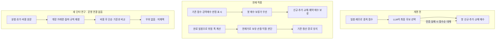

# 이번 개편의 실제 적용 범위 · 2026-10-25

기준 `main c452b77`(#830). 새 단타 후보는 비용 후 비교를 통과하지 못해 운영에 채택하지 않았다.
이번 배포에서 바뀐 것은 위험 계산·매수 통제·평가·원천 수집이다. 수익성 개선은 아직 입증되지 않았다.
아래 매수·청산은 봇 모의투자 경로다. 토스 수동 실주문은 별도 경로이며 이번 단타 연구에 연결하지 않았다.

## 사용자에게 달라진 점

1. **하락할수록 손절 폭이 늘어나는 계산 오류를 수정했다.** 완료 일봉으로 구해야 할
   일간 변동성에 현재가가 섞이던 경로를 분리했다. 합성 재현의 손절 폭은 약3.24%에서2.78%로
   돌아왔다. 특정 실제 거래의 손실이 그만큼 줄었다는 뜻은 아니다.
2. **LLM 키가 만료돼도 점수순으로 대신 매수하던 경로를 보류했다.** 보류 스위치가
   신규·추가·교체·예약 매수에 우선한다. 키 복구만으로 재개되지 않는다. 기존 보유의 손절·
   익절·트레일링 청산은 계속 판단하며, 가격·거래 가능 조건을 충족해야 실행될 수 있다.
3. **매도를 보류한 종목을 같은 실행에서 추가매수하는 충돌을 제거했다.** 승인한 매수 보류가
   나중에 풀려도 이 실행 충돌 검사는 남는다. 실제 과거 손실 중 기여액은 미측정이다.
4. **LLM 평가에서 일부 종목을 고르지 않아 남는 현금도 계산한다.** 일부 기권의 결과를 버리던
   평가 오류를 수정했다. 이는 선정 평가이며 실계좌 수익률이나 LLM 재학습이 아니다.
5. **시세·판정 기록을 지우지 않고 중복 저장 구조를 정리했다.** 동일 조회 인덱스를 제거해
   약39.6MB를 DB 내부에서 재사용하도록 했고 만료 응답44개를 정리했다. 물리 파일 크기와
   Railway 사용량이 그만큼 즉시 줄어든 것은 아니다.

화면의 강력매수는 기존 상대 순위 판정이다. 현재 봇의 신규 주문 허가와 동일하지 않다.
`BOT_BUY_PAUSED`를 토스 계좌의 모든 수동 주문까지 차단하는 스위치로 설명하지 않는다.
기존 advisor 코드는 남아 있다. LLM을 설명 전용으로 제한한 새 장중 구조는 설계이며, 운영의
모든 LLM 주문 권한이 이미 제거됐다고 설명하지 않는다. 새 후보는 과거 미국 고정8종목 연구다.
국내·미국 전체 종목에 새 단타 엔진을 가동한 상태가 아니다.

## 검수 자료

- [위험 계산·LLM 평가 결함과 새 장중 설계](ENGINE-INTRADAY-REBOOT-2026-10-25.md)
- [매수 보류·저장소 정리의 운영 확인](OPS-STORAGE-BUY-PAUSE-2026-10-25.md)
- [보유 청산 보류와 추가매수 충돌](KR-OPERATING-TRADE-REVIEW-2026-10-25.md)
- [808,320분봉·542호가 요청·비용 대조 결과](INTRADAY-ORB-RECONSTRUCTION-2026-10-25.md)

운영 진단 수치는 앞선 배포 확인 시점의 관측이다. 이 문서 작성 때 새 배포나 실주문을 실행한 것은 아니다.
개편 적용과 수익성 채택을 구분하며 **통합40/100 유지**다.
