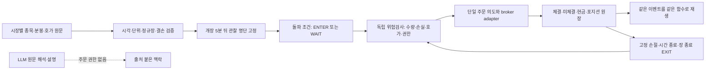

# 엔진 리부트: 일봉 순위와 당일 매매를 분리한다

기준: `main 7904cba`(#825), 2026-10-25. 엔진 호출 경로·보존 원천·외부 연구를 병렬 감사했다.
이 문서는 새 단타 정책의 설계 정본이다. 기존 등록 실험의 설정·표본·판정은 대체하지 않는다.
**수익성 채택은 아직 없다.** 이번 변경은 재현된 위험 계산/평가 결함 수정과 사용하지 않는 경로 정리다.

## 1. 결론부터

문제는 “지표가 부족해서”라기보다 **다른 시간대의 판단을 하나의 매수 신호로 연결한 것**이다.
현재 엔진의 중심은 재무·가치·퀄리티와 12–1개월 모멘텀이다. 그런데 사용자는 당일 진입·청산을
기대하고, 봇의 LLM 선택·분할매수·회전·손절은 또 다른 시간 기준을 쓴다.

따라서 기존 점수에 새 점수·AI·필터를 더하지 않는다. 기존 일봉 정책은 재현 가능한 비교 대상으로
남기고, 새 정책은 **대형주·유동성 → 장중 거래 기회 → 진입 → 독립 위험관리 → 청산**으로 분리한다.
장중 호가, 비용, 공개시각을 모르는 상태에서 새 엔진을 운영 매수에 연결하지 않는다.

사용자의 목표는 정량 자료와 규칙으로 당일 거래하는 **시스템 단타/장중 퀀트 전략**에 해당한다.
다만 하루 1–3% 보장은 검증 기준이 될 수 없다. 거래 하나의 가격수익과 전체 계좌수익도 다르다.
예를 들어 연구상 계좌의 20%를 투입해 종목에서 1%를 벌면 비용 전 계좌 기여는 약 0.2%다.
매일 1% 목표를 채우기 위한 강제 거래·배팅 확대·손절 연장은 금지한다. 거래가 없는 날도 정상이다.

## 2. 현재 구조와 실제 문제

감사 기준 코드 위치는 변경 전 `7904cba`다. 수정 후 줄 번호와 혼동하지 않는다.

| 층 | 현재 동작 | 문제와 판단 |
| --- | --- | --- |
| 선정 | `engine.py:864–1037`: 일봉 팩터, 기본 상위 3% 창, coverage/추세/이벤트 게이트 | 상대 순위가 당일 상승 확률이나 진입 허가를 뜻하지 않음 |
| 갱신 | `store.py:2337–2365`: 일봉 끝에 현재가 한 점 추가 | 일봉 점수의 빠른 재계산이지 분봉 단타 전략은 아님 |
| 진입 | `bot.py:1026–1085`: 정량 후보 뒤 LLM이 부분집합·순서·개수·기권 결정 | 뉴스 감성이 점수에 직접 안 들어가도 최종 매수에는 영향을 줌 |
| 진입 변형 | 신규매수·회전·ADD·예약이 별도 판단 | 서로 다른 선정/배분 계약. 새 정책에서는 한 진입 의도로 통합 |
| 청산 | 현재가로 손절·익절·트레일링; 기본 장마감 강제청산 없음 | “당일 거래”와 맞지 않음. 운영 기존 보유를 갑자기 강제청산하지는 않음 |
| 평가 | 판단 기록 3거래일, 등록 비교 5거래일, advisor shadow 기본 20거래일 | 실제 보유·실제 체결과 같은 목표가 아님 |
| 학습 | 최근 성패를 LLM 프롬프트에 삽입 | 모델 재학습이나 보정된 확률이 아님. 시장/지평도 명확히 분리돼 있지 않음 |

### 이번에 수정한 재현 가능한 결함

1. **현재 하락이 손절 폭을 넓히는 입력 혼용.** `bot._risk_for`는 완료 종가를 의도했지만
   현재가가 추가된 배열로 일간 변동성을 계산했다. 완료 종가를 100/101 반복 21개, 평단100,
   현재가97로 둔 합성 사례에서 완료봉 손절은 약 −2.776%라 발동하지만, 현재가를 섞으면
   약 −3.244%로 넓어져 발동하지 않는다. 같은 캡처에서 완료 일봉과 현재 관측값을 분리한다.
   신규 수량의 일간 변동성에도 같은 분리를 적용한다. 손절 배수·가중치 튜닝은 하지 않는다.
2. **LLM 부분 기권의 평가 누락.** 기준 `[A,B]`, LLM `[A]`일 때 기존 shadow는 남는 현금과
   제외한 B의 수익 차이를 버렸다. 전체 기권만 평가하던 비대칭을 수정한다. 누락 수익은
   현금0으로 치환하지 않는다. 이 수치는 20일 선정 대조이며 실거래 수익 인증은 아니다.
3. **호출처 없는 예약 생성기 제거.** `generate_reservations`는 저장소 Python 호출처가 없고
   별도의 LLM/절대점수 진입 경로를 복제한다. 함수만 제거한다. 기존 예약·원장·예약 실행 및
   최종 위험 재검사는 보존한다. 과거 기록을 삭제하거나 이미 있는 주문을 취소하지 않는다.

shadow에는 `pairing_version=rank-slots-with-cash-v2`를 남기고 이전 측정 캐시를 재사용하지 않는다.
원래 선택 기록은 보존한다. 기존 실행정책 ID가 수정된 소스 해시를 포함하므로 배포 전후를 구분한다.
1·2는 수익성 가설이 아니라 코드 계약 결함이다. 실제 과거 손실 중 얼마를 설명하는지는 미측정이다.
특히 1의 합성 재현을 HD현대 실제 손실의 원인이라고 단정하지 않는다.

## 3. 무엇을 남기고 무엇을 덜어내나

| 처리 | 대상 | 범위 |
| --- | --- | --- |
| 그대로 재사용 | `market_clock`, KIS/Alpaca 파서, 원문 해시, 관측 ID, 가격 신선도, 주문 위험검사, 비용·현금·체결 원장, replay | 새 프레임워크로 전면 재작성하지 않음 |
| 비교 정책으로 보존 | 8팩터, 현재 rank/가중치, 등록 연구, 기각된 실험 원장 | 기존 결과를 새 장중 엔진의 실적으로 포장하지 않음 |
| 새 장중 주문 경로에서 제외 | LLM 최종 픽/challenger, 장기 가치 점수, PER 저평가 보상, 매일 분할매수, 점수차 회전, 중복 예약 생성 | 이번 배포에서 기존 정상 매매 정책을 몰래 교체하지 않음 |
| 설명으로 제한 | 재무·산업·거시·뉴스·외국인/기관의 일별 수급 | 정보 공개/수신시각과 유효기간 표시. 당일 미래 수급을 조기 입력하지 않음 |
| 초기 미도입 | RL, 다중 AI 토론 매매, 벡터 DB 확대, 종목별 자동 룰 생성, 새 점수 앙상블 | 새로운 정보·비용 후 우위가 확인되기 전 복잡성만 늘리지 않음 |

뉴스/재무 원천은 지우지 않는다. **기록 보존과 주문 권한 제거는 다른 일**이다. 저PER 자체로 단타
후보를 올리지도, 고PER 자체로 제거하지도 않는다. 위험 경고·정지·종목 식별 오류는 별도 문제다.
기업행사 전수 조사와 Paperclip은 재개하지 않는다. 이번 사용자 요청으로 KR/US 조사 범위는 다시
열었지만 유료 데이터 계약·실주문·계좌 공매도 활성화는 수행하지 않는다.

## 4. 외부에서 차용할 것과 차용하지 않을 것

문헌 수익률은 Signal Desk 성적이 아니다. 아래 문헌은 **검증할 가설과 설계 원칙**을 제공한다.

| 사례 | 차용 | 적용 한계 |
| --- | --- | --- |
| [Zarattini·Barbon·Aziz ORB 연구](https://concretumgroup.com/wp-content/uploads/2026/02/A-Profitable-Day-Trading-Strategy-For-The-U.S.-Equity-Market.pdf) | 개장 범위 + 같은 시간 상대거래량으로 거래 기회 한정 | 넓은 미국 종목군·상위20과 대형주 상위2는 다름. 한국·아래 보유/손절 규칙은 새로운 가설 |
| [VWAP 연구](https://concretumgroup.com/wp-content/uploads/2026/02/Volume-Weighted-Average-Price.pdf) | 가격과 거래량의 관계를 정의하는 참조 | 추세 전략이고 슬리피지0 가정. VWAP 평균회귀가 검증됐다고 읽지 않음; 첫 후보에 섞지 않음 |
| [LEAN 실전 대조](https://www.quantconnect.com/docs/v2/writing-algorithms/live-trading/reconciliation) | 연구/실시간의 입력·주문·체결 차이를 각각 비교 | 같은 전략 코드라도 수정 데이터와 체결 모형 차이 존재 |
| [NautilusTrader 공통 코어](https://nautilustrader.io/docs/latest/concepts/overview/) | 이벤트 기반 단일 전략 함수와 실행 계층 분리 | 전면 이관/새 broker 통합의 이점은 별도 검증. 이번에는 개념만 재사용 |
| [Qlib](https://github.com/microsoft/qlib/blob/main/docs/component/highfreq.rst), [FinRL](https://github.com/AI4Finance-Foundation/FinRL) | 시점 일관성·실험/학습/실행 분리 | 라이브러리 설치가 선정력·실제 비용·한국 브로커 적합성을 입증하지 않음 |
| [TradingAgents 공식 저장소](https://github.com/TauricResearch/TradingAgents) | 구조화된 근거, 반증 질문 | 연구 도구이며 결과가 모델·설정·데이터에 의존. agent 합의를 수익 확률로 사용하지 않음 |
| [백테스트 과적합 연구](https://www.davidhbailey.com/dhbpapers/backtest-prob.pdf) | 시도 횟수 보존·분리 평가·선택 편향 경계 | 이미 반복 열람한 창에서 또 승자를 찾고 독립 검증이라 하지 않음 |

[미국 주문 충격 연구](https://arxiv.org/abs/1412.2152)는 참여율과 실행기간도 비용에 영향을 줌을
보인다. 논문 계수를 그대로 이식하지 않고 실제 주문 규모·호가·지연에 따른 비용 스트레스를 둔다.
LLM 연구 전체도 비교 가능한 시계열 분할·비용·재현성의 부족을 지적한다.
[LLM 거래 연구의 평가 감사](https://arxiv.org/abs/2605.19337).

## 5. 새 구조: 한 판단, 한 실행 경로

- `UniverseSnapshot`: market/venue/security_id/currency, 기준일, 가용시각, 시총·거래대금 산출 창.
- `MarketEvent`: source_time/received_at/usable_at, bar_start/end/completed, feed, 단위, 원문 ID.
- `EntryIntent`: policy/input IDs, market/side/ticker, decision_at, expires_at, entry_limit,
  initial_stop, exit_deadline, reason. 종목·수량·허용가격을 LLM 문자열에서 파싱하지 않는다.
- `PositionState`: 체결 수량/평단, 처음 고정한 위험, 실제 체결시각, 요청 중 청산, 세션 내 사용 이력.
- `FillEvent`: 제출/수락/체결/취소시각, 실제 수량/가격, 수수료/세금/차입비, 부분체결·거절 원인.

위 항목은 계약이다. 아직 연결하지 않은 공통 모듈/서비스를 미리 여러 개 만들지 않는다.
기존 관측·체결/의사결정 모듈에 어댑터를 붙이고 필요한 순수 정책 함수 하나만 구현한다.
신규 진입과 보유 청산을 독립 처리하며, `exit_requested`가 있으면 진입보다 우선한다.

### LLM의 역할과 비용

현재 `llm.DEFAULT_MODEL`은 Opus 계열이며 advisor는 최종 선택권을 가진다. 모델 이름을 바꾸는
것으로 이 권한의 정당성이 생기지 않는다. 최근 성패 프롬프트도 학습된 예측 모델은 아니다.

새 장중 경로는 LLM 호출0으로도 동일한 판단을 내린다. LLM은 새 원문의 기업·기간·사건 종류·
인용 구절을 구조화하고, 사용자가 요청한 설명을 만든다. source ID·공개시각·수신시각·정정·
만료가 없으면 “모름”이다. 감성이나 모델 확신만으로 매수/숏/손절/추가매수/기권을 바꾸지 않는다.
확정 공시 위험을 사용할 때에도 회사 식별과 사실 검증을 통과한 구조화된 입력만 코드가 소비한다.

설명은 문서 해시/버전으로 캐시한다. 틱마다 두 모델을 호출하지 않는다. 기존 공통 LLM 예산
게이트는 보존한다. 데이터 이용료는 실제 계정 권한 확인 전 무료라고 가정하지 않는다.

## 6. 후보 하나: `largecap-orb-rvol-v1` 설계

다음 값은 최적값이나 수익 보장값이 아닌 **첫 연구의 고정 규칙**이다. 아직 성과를 열지 않았다.
시장별 0–2종목 연구이며 두 시장을 합해 매일 반드시2개를 고르는 규칙은 아니다. 운영 전환 시에는
합산 진입 횟수·계좌 예산을 별도 확정해야 한다. KR/US 결과는 별도로 판단한다.
초기 실행 대상은 현금 기반 long-only다. short는 분석만 가능하며
대차/주문 가능 수량·비용·가격규칙이 확보된 뒤 별도 정책 ID로 검증한다.

| 항목 | 고정할 규칙 |
| --- | --- |
| 유니버스 | 전일 당시 시총 상위100 보통주 중 직전20세션 거래대금 중위 상위50. KR/US 각각 산출. ETF/우선주/SPAC/OTC/정지·경고는 제외; 당시 상태 불명이면 미확인 |
| 저가/급등 위험 | 전일 종가 KR 5,000원·US $10 이상. 개장 갭 절댓값 5% 초과 또는 첫5분 범위/시가 2% 초과 제외. 이는 리스크 제한이지 최적화된 알파 아님 |
| 개장 자료 | 거래소 캘린더 정규장 `[open, open+5분)`의 완료 OHLCV. 동일 feed/경매 포함 정책의 직전14세션 모두의 첫5분 거래량 필요. 일별 평균 거래량을 대신 쓰지 않음 |
| RVOL | 오늘 첫5분 거래량 / 직전14세션 같은 구간 평균. 분모0·결측은 모름. RVOL≥1; 동일값은 security_id 오름차순 |
| 명단 고정 | 개장+5분 이후 자료 도착 watermark에서 RVOL 상위 최대2를 한 번 고정. 나중에 돌파한 종목 중 좋은2개를 사후 선정하지 않음. 빠진 자리를 하위순위로 보충하지 않음 |
| 방향 | 첫5분 종가>시가인 명단 구성원만 long 가능. 낮으면 short 관찰 또는 WAIT. long-only를 이유로 세 번째 종목을 새로 채우지 않음 |
| 진입 | 명단 고정 후 완료1분봉 종가가 첫5분 고가를 처음 상향 돌파. 다음 이용 가능한 정상 ask부터 주문 가능. 같은 봉 고가/종가를 체결가로 쓰지 않음 |
| 유효시간 | `t < open+60분`일 때만 신규 진입. 후보별 한 번의 진입 의도, 미체결 후 무한 재시도·그날 재진입·물타기 없음 |
| 추격 제한 | 제출 가능 ask가 첫5분 고가+개장 범위의0.25를 넘으면 거래 안 함. spread≤10bp 및 유효시각/양쪽 수량 검증. 돌파 가격에 유리한 가상 체결 금지 |
| 초기 위험 | 첫5분 저가를 long 손절 기준으로 동결. 체결가−손절가가 R. 손절을 아래로 옮기지 않음 |
| 청산 | 손절, 체결가+2R, 실제 첫 체결 후60분, 연속매매 종료5분 전 중 먼저 온 조건. 손절은 기준가격에서 반드시 체결된다는 보장이 아님 |
| 연구 수량 | 1회 예정 손실 NAV0.25% 이내, 종목별 원금20% 이내, 총40% 이내, 정수주. 현금 차입0. 당일 손실0.75%에서 신규 진입 중단; 기존 위험 청산은 계속 |

수량은 주문 전 허용 최고 진입가격을 사용해
`min(위험 예산/(최고진입가−손절가+주당비용), 원금 한도/최고진입가,
가용현금/비용포함최고진입가, 검증된 유동성 한도)`의 정수 내림으로 정한다.
부분체결의 미체결 예약 위험도 합산하며, 마지막 부분체결을 핑계로 보유 종료시각을 연장하지 않는다.
표의10bp·원금/손실한도는 **연구 비교값**이지 안전하다고 인증한 운영값이 아니다.
시장별 수수료·세금·호가단위·주문 참여율/잔량 단위·수신 watermark와 지연 허용값은
현재 `UNRESOLVED / blocks execution`이다. R1에서 성과를 보기 전에 원천/계정 계약으로 확정한다.
수정된 과거5분봉이나 늦게 도착한 종목으로 이미 확정된 명단을 소급 교체하지 않는다.
KR 종가 단일가·US 조기폐장/DST는 기존 `market_clock`을 재사용한다. 거래정지로 장 종료 청산이
안 되면 강제로 “현금” 처리하지 않고 미청산 사고/밤새 노출을 기록한다.

1~3% 도달률은 부수 보고값이다. 목표에 못 미쳤다는 이유로 종목 수·레버리지·보유시간을 늘리지 않는다.
다른 고정값을 시험하면 같은 v1을 덮어쓰지 않고 새 후보로 기록한다.

## 7. 자료는 어디까지 준비됐나

원천 감사는 실제 ZIP manifest/해시와 코드 기준이다. 로컬 DB를 운영 수집 현황으로 해석하지 않는다.

| 자료 | 확보한 것 | 새 후보에 부족한 것 |
| --- | --- | --- |
| KR 일봉 | 날짜별 OHLCV·시총·거래대금·상장주식수 원문 | 당시 사용 가능 버전/종목 상태, 개장5분과 체결은 일봉으로 복원 불가 |
| KR 분봉 | 계약 사건45건×종목/대조, 원문90응답 | 대형주 전체의 연속14세션+당일 OHLCV 패널, 정상 양방향 호가·수량·VI 상태 |
| US 사건/호가 | 고정8회사 2022/23 발표64건과 SIP·기사; 2020/21 별도 원문 | 연속 대형주 유니버스/분봉, 일부 호가의 정상 조건·수량 단위, 실제 당시 수신시각 |
| 운영 관측 | source time/관측 ID/provider를 가진 last-price 원장 | lastPrice는 NBBO bid/ask·잔량이 아님. quote라는 테이블명이 체결 호가를 보장하지 않음 |
| 숏 | 일별 공매도 비중 자료 | 대차 가능 수량·유효시각·차입비·계좌 및 broker/API 공매도 권한 |

확인한 ZIP 해시 앞부분: 계약 사건 `8943c37c`, 2022/23 발표 `0f7cc684`, 새 가이던스 `36c57565`.
원문은 이미 보고서에 보존돼 있다. 자료를 다시 긁거나 같은 실패 실험을 다시 돌리지 않았다.

준비도는 세 단계로 나눈다: **A 당시 수신까지 보존 / B 과거 시장 원문으로 재구성 / C 일봉·
부분 반응 진단**. B자료로도 고정 지연/비용 가정의 유용한 백테스트는 할 수 있다. 하지만 A수신
시각을 만들어 넣거나 B성과를 실시간 전달 능력의 증거로 사용하지 않는다.

현재 원문은 과거 가설을 기각하고 구현을 검수하기에는 유용하다. **위 ORB 후보를 두 시장 전체에서
비용 후 평가할 자료는 미충족**이다. 기업행사 전수검수 때문에 모든 단타 연구를 멈추지는 않는다.
단타 입력의 가격 단위·분할/배당락·정지/상장변경도 무시하지 않으며 해당 일은 명시적 결손으로 남긴다.

운영 관리자 화면도 2026-10-25에 읽기 전용으로 확인했다. 국내/미국 시세는10/23 기준 최신 표시,
KB는 대상20종목 중 현재 근거2종목·없음18종목, 컨센서스는 관측21일·발표시각 인증0건이었다.
FRED 원/달러10/16 및 ECOS 월별 자료에 원천 관측일 확인 경고가 있었다. 이것만으로 월별 자료가
실제로 수집 실패했다고 단정하지 않는다. 화면은 대형주 전체의 연속 호가/분봉 완전성을 입증하지
않으며, 휴일인10/25의 최근5분 현재가 부재를 장중 고장으로 세지 않는다. 새 수집/설정 변경은0이다.

## 8. 기존 백테스트에서 이어받을 결론

- [전체 손실 진단](KR-WHOLE-CHAIN-DIAGNOSIS-2026-10-23.md): 선정·보유 지평·비용을 분리해야 함.
- [운영/연구 대조](KR-OPERATING-SELECTION-PARITY-2026-10-23.md): 같은 엔진 코드라도 입력/설정/LLM/보유가 다르면 운영 재생이 아님.
- [학습 표본 감사](KR-SAMPLE-INFORMATION-AUDIT-2026-10-23.md): 짧고 겹치는 라벨, 종목별 고정 재무, 고변동 집중. 모델을 크게 하는 것으로 새 정보가 생기지 않음.
- [보유 교차 비교](KR-SELECTION-HORIZON-CROSS-RESULT-2026-10-23.md): 80경로를 끝냈지만 h5 후보는 기각. h20 승자를 보고 방향을 뒤집어 채택하지 않음.
- [계약 사건](CONTRACT-EVENT-BACKTEST-2026-10-17.md): 큰 호재와 이미 나타난 반응 뒤의 잔여 움직임은 별개.
- [미국 발표 직후](EARNINGS-ANNOUNCEMENT-RESULT-2026-10-17.md): 승률, 종목 집중, 비용·스프레드를 함께 봐야 함.
- [가이던스](EARNINGS-GUIDANCE-RESULT-2026-10-17.md): 원천 품질 차단은 기각과 다름. 같은 결손으로 재실행하지 않음.

기존 일별 `trend_leader/leader_pullback/volume_breakout`의 기각은 전일 특징→다음 시가/종가
연구 결과다. 오늘 장중 거래량으로 판단하는 ORB와 같지 않다. 반대로 이름만 바꿔 기존 실패를 재시험하지 않는다.

## 9. 검증 계약 — 자료 확보 후, 성과 열기 전에 봉인

첫 단계는 수익률 계산이 아니라 적격 종목×세션의 입력 가용성 표다. 기존 parser를 재사용하며
새 수집이 필요하면 범위·권한·무료/유료·저장량을 먼저 확인한다. 유료 구매는 별도 사용자 승인이다.

1. **표본:** 미래 성과를 읽기 전에 시장별 기간·구성종목·feed·정정 방식·원문 해시를 확정한다.
   반복 열람한7개 개발창·등록 보호창은 새 독립 평가로 쓰지 않는다. 과거 연속 원문을 얻으면
   미래 몇 달을 기다릴 필요는 없다. 현재는 가능한 날짜를 확인하지 못했으므로 날짜를 지어내지 않는다.
2. **분할:** 시장별 최소240세션(+20세션 warm-up) 확보를 첫 연구 규격으로 둔다. 시간순
   120 개발/60 검증/마지막60 봉인평가, 블록 경계를 넘는 장중 포지션 없음. 데이터 종료일·경계는
   가용성 메타데이터만으로 정한다. 이는 충분한 검정력을 보장하는 숫자가 아니며 부족하면 미결론이다.
3. **단순 대조:** 동일 유니버스·돌파/청산/비용/사전 위험한도의 전일 기준20세션 거래대금 중위순
   상위2 ORB와 RVOL 상위2 ORB,
   현금0을 비교한다. 양수/음수 방향 및 미돌파도 동일한 no-refill 규칙. 같은 명단/수량에서의
   익절·손절 없는 동일 만기 markout은 원인 진단용이지 별도 승격 후보가 아니다.
4. **동일 위험:** 동일 한도만 맞췄다고 실현 위험까지 같다고 하지 않는다. 실제 노출·거래횟수·
   변동성·낙폭·비용을 공개한다. 추가 위험 정렬은 개발창에서 정한 축소계수만 후반에 고정 적용한다.
5. **체결:** 결정 이후 실제 이용 가능한 ask 매수/bid 청산, feed/호가 조건·잔량 단위·지연·정수주·
   부분체결·미체결·수수료/세금을 반영한다. 호가가 없으면 가격반응 연구로 강등하고 수익성 채택 금지.
   분봉 하나에 손절/익절 둘 다 닿으면 순서를 상상하지 않는다. 더 세밀한 원문 또는 보수적 손절 우선
   스트레스가 필요하며, 그 결과가 결론을 바꾸면 미결론이다.
6. **스트레스:** 기본 실측 비용, 수수료/슬리피지2배(스프레드 중복 공제 금지), 제출 지연+60초,
   잔량50%의 경로를 고정한다. 유리한 경로만 본 뒤 표준값을 다시 고르지 않는다.
7. **채택:** 거래 없는 날까지 포함한 계좌 일별 수익을 사용하며 같은 날2종목을 독립 표본으로 세지 않는다.
   봉인평가 기본 비용 후 누적수익>0, 단순 ORB 대조 대비 일별 초과수익의 블록
   bootstrap 보정 하한>0, 스트레스 순이익>0, 개발창에서 고정한 위험 한도 준수. KR/US 두 주장에는
   다중검정 보정(각 단측97.5% 하한)을 적용한다. 세션 단위5일 블록·10,000회·고정 시드20261025.
   세부 노출/낙폭이 대조보다 악화되면 우위라 하지 않는다. 이 검정도 약한 의존성/정상성 가정이 있다.
   최소 의미 효과·검정력과 필요한 길이는 개발창만으로 평가하고 봉인 전 기록한다.
   60일이면 충분하다고 가정하거나 부족한 표본의 날짜를 줄여 통과시키지 않는다.
8. **집중도:** 최상위 기여 종목 하나와 최상위 기여 세션 하나를 각각 제거한 감도에서 순이익이
   음수가 되면 특정 종목/일 의존으로 미채택한다. 제거한 성적을 본성과로 바꾸지 않는다.
9. **운영 연결:** 채택 후에도 보존된 실시간 입력→동일 판단 replay, 주문 상태 복구·중복 방지·
   위험 청산·데이터 단절 경계를 확인한다. 실계좌/숏 권한은 별도 확인한다. 재시도는 이유와 한도 명시.

개발창이 좋더라도 봉인평가를 보기 전 후보/기준을 바꾸면 새 버전이다. 첫 봉인평가 실패 후 같은
구간을 학습해 다시 통과시키는 자동 자가학습은 하지 않는다. 시스템은 오차와 원인을 모을 수 있지만
**새 후보 제안 → 독립 비교 → 검수 → 승격** 없이 실전 파라미터를 스스로 바꾸지 않는다.

## 10. 시장별 제약

- US IEX와 SIP는 같은 거래량/호가가 아니다. RVOL 분자·분모 및 연구·실시간 feed를 맞춘다.
  오래된 SIP 접근 가능 여부와 최신 SIP 권한은 별개다. [Alpaca 공식 FAQ](https://docs.alpaca.markets/us/docs/market-data-faq).
- US 숏은 locate·주문표시·Rule201 등 조건을 확인한다. [SEC Reg SHO](https://www.sec.gov/investor/pubs/regsho.htm).
  KR도 차입·업틱·과열 제한과 해당 broker/API 권한이 필요하다. [KRX Q&A](https://data.krx.co.kr/contents/MDC/STAT/srt/MDCSTAT317.jsp).
- 2026년 미국 intraday margin 규정은 broker 전환 기간이 있어 `$25k/PDT/4배`를 보편 상수로
  박지 않는다. [FINRA 안내](https://syndication.finra.org/content/understanding-new-intraday-margin-requirements).
- 브라우저 SSE는 화면 배포 방식이다. 거래소 원천 feed의 지연·권한·누락을 해결하지 않는다.
  초기1분봉 전략은 완료봉 기준이며, 1분 갱신으로 순간 호재를 가장 먼저 잡는다고 약속하지 않는다.

## 11. 실행 순서와 완료 기준

| 순서 | 작업 | 끝나는 조건 |
| --- | --- | --- |
| R0 | 이번 엔진·자료·외부 조사 + 재현 결함2개 + dead path 제거 | 독립 리뷰, 경계검사, 정확한 PR HEAD CI, 머지; 배포 확인은 별도 |
| R1 | KR/US 최소 원천 가용성 어댑터 | 실제 과거 연속14세션 첫5분과 정상 호가/수량·당시 universe가 존재하는지 표로 확정. 없으면 정확한 부족 항목·비용만 보고 |
| R2 | 위 단일 정책과 기존 실행 원장 어댑터 | 동일 입력 동일 intent, 미래/불완전/혼합feed 거부, 연구 runner 연결. 입력 없는 추상 framework를 미리 양산하지 않음 |
| R3 | 고정 비교와 채택/기각 | 기본·스트레스·집중도·봉인평가; 자료미달/실패/성공을 구분 |
| R4 | 실시간 shadow와 명시적 운영 전환 | 현재자료/주문기능/재생·복구 확인 후만. 기존 일봉 정책/장부와 별도 ID |

이번 리부트의 다음 한 작업은 R1이다. 새 모델 튜닝이나 기업행사 원천 전수조사가 아니다.
원천이 충분하지 않은 상태에서 R2–R4를 완료했다고 보고하지 않는다. 설계·안전성 개선과
수익성 개선은 별개다. 기존 통합 로드맵은 **40/100 유지**하며 이 설계 추가로 올리지 않는다.

### 구현 검수

독립 code-reviewer가 완료봉 분리·미국 세션 경계·부분 기권·캐시 버전·예약 생성 호출처를 검토했다.
매수 주문 payload/filled-buy 원장의 두 위험 값도 같은 완료봉을 사용하도록 추가 수정한 뒤 승인했다.
작업자 관련344개 검사와 완료봉 부족 경계2개 통과, controller 핵심101개 검사 통과,
`git diff --check` 통과다. 이 검사는 코드 계약 검증이지 수익성 백테스트가 아니다.
머지/CI 결과는 해당 PR에서 정확한 HEAD 기준으로 확인한다. 운영 적용은 배포 확인과 구분한다.
